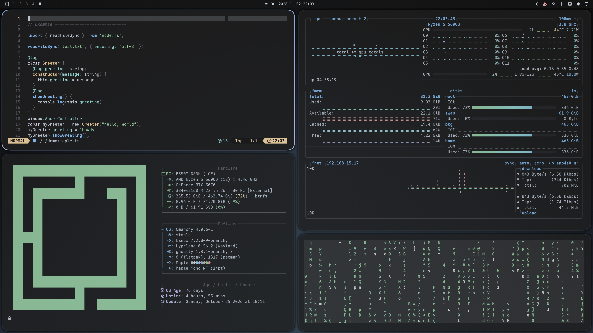

<div align="center">

# 🍁 Maple for Omarchy

**A soft, low-contrast pastel theme for [Omarchy](https://omarchy.org), ported from [Maple Dark](https://github.com/subframe7536/vscode-theme-maple).**



</div>

## Install

```bash
omarchy theme install https://github.com/leolimasnts/Maplemarchy.git
```

Then pick **Maplemarchy** in the theme menu (`Super + Ctrl + Shift + Space`) or run:

```bash
omarchy theme set maplemarchy
```

## Font

The screenshots use **[Maple Mono](https://github.com/subframe7536/maple-font)**, the companion font to the Maple theme. Install the Nerd Font build and set it as your system font:

```bash
omarchy pkg add maplemono-nf-cn
omarchy font set "Maple Mono NF"
```

## Palette

| | Color | | Color |
|---|---|---|---|
|  Background | `#1e1e1f` |  Foreground | `#cbd5e1` |
|  Red | `#edabab` |  Green | `#a4dfae` |
|  Yellow | `#eecfa0` |  Blue | `#8fc7ff` |
|  Magenta | `#d2ccff` |  Cyan | `#a1e8e5` |
|  Orange | `#f0c0a8` |  Muted | `#5f5f68` |

Window borders use a blue → lavender gradient (`#8fc7ff` → `#d2ccff`).

## Compatible applications

| Area | Applications |
|---|---|
| Desktop | Hyprland (borders), Omarchy shell (bar, menus, launcher, notifications, OSD), lock screen, polkit prompt, GNOME/GTK apps, Yaru-blue icons |
| Terminals | Ghostty, Alacritty, Kitty, Foot |
| Terminal apps | btop, tmux, gum, opencode, Claude Code, pi, hermes |
| Editors | Neovim / LazyVim, Helix, VS Code, VSCodium, Cursor, Obsidian |
| Browsers | Chromium, Chrome, Edge, Brave (toolbar color) |
| Other | t3code, RGB keyboard backlight |

### Local install (full Maple experience)

For safety, `omarchy theme install` ignores a few file types from git-installed themes and generates them from `colors.toml` instead. The theme still looks like Maple, but you lose:

- Maple's exact terminal ANSI palette (`ghostty.conf`, `kitty.conf`, `alacritty.toml`, `foot.ini`).
- The official [Maple Dark](https://marketplace.visualstudio.com/items?itemName=subframe7536.theme-maple) VS Code extension (`vscode.json`).

To keep those files, clone the repo and link it as a local theme:

```bash
git clone https://github.com/leolimasnts/Maplemarchy.git ~/Projects/Maplemarchy
ln -s ~/Projects/Maplemarchy ~/.config/omarchy/themes/maplemarchy
omarchy theme set maplemarchy
```

## Wallpapers

The theme ships 19 soft 4K gradients in [`backgrounds/`](backgrounds), all drawn from the Maple palette. Each one stays dark enough that Maple's text color keeps at least a **7:1 contrast ratio** (WCAG AAA) anywhere on screen. Cycle through them with `omarchy theme bg next`.

Add your own (jpg, png or webp) to `~/.config/omarchy/backgrounds/maplemarchy/`. To make more gradients, edit the list in [`tools/gen_walls.py`](tools/gen_walls.py) and run `python3 tools/gen_walls.py backgrounds 1.6` (needs ImageMagick).

## Credits

- **[Maple Dark](https://github.com/subframe7536/vscode-theme-maple)** by [subframe7536](https://github.com/subframe7536): the original VS Code theme this port is based on. All colors come from its palette (MIT License).
- **[Maple Mono](https://github.com/subframe7536/maple-font)** by [subframe7536](https://github.com/subframe7536): the font shown in the preview.
- **[Omarchy](https://omarchy.org)** by DHH and contributors: the theming system this builds on.

Released under the [MIT License](LICENSE).

If you like this theme, give the original [Maple theme](https://github.com/subframe7536/vscode-theme-maple) a ⭐.
